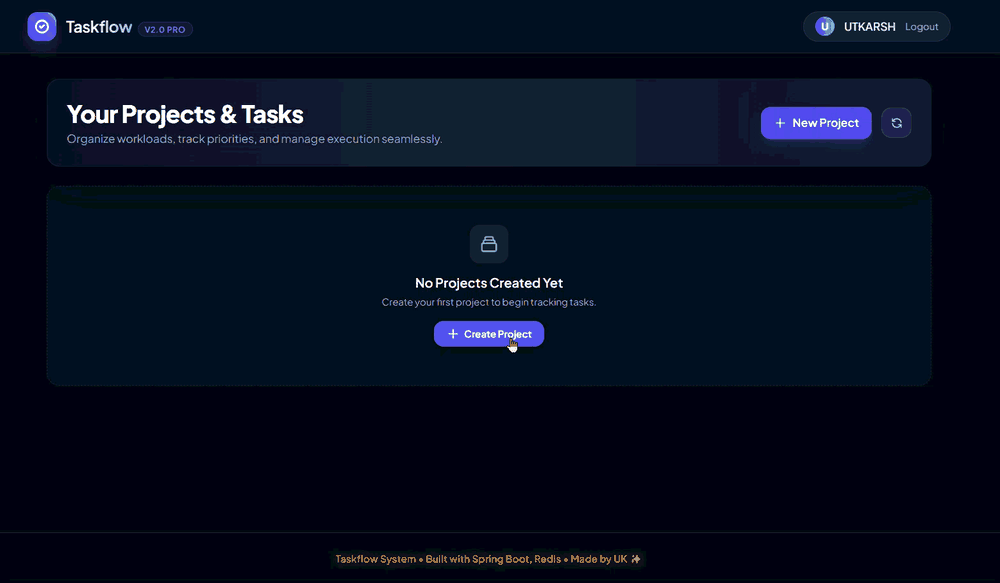
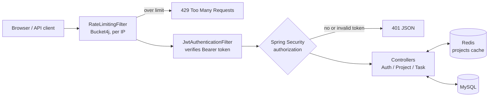

# Taskflow

A project and task manager built with Spring Boot. Each user signs up, gets a JWT, and manages their own projects and the tasks inside them. Project lists are cached in Redis, and the API is rate limited per client IP. The single-page frontend is served by the same Spring Boot app.


## Demo



The GIF starts on an empty dashboard for a logged-in user. It then shows:

1. **Create a project.** Clicking **Create Project** opens the modal. The user enters a title (the description is optional) and saves. A "Project created" toast appears and the list reloads.
2. **Add a task.** **Add Task to "A"** opens the task form with a title, a description, and dropdowns for **Priority** (Low, Medium, High) and **Status** (To Do, In Progress, Done).
3. **Save the task.** It appears under its project with priority and status badges.

A longer recording is in [`docs/media/taskflow-demo.mp4`](docs/media/taskflow-demo.mp4).

## Features

- **Accounts and JWT auth.** Users register and log in through `/api/auth`. Passwords are hashed with BCrypt, and every other `/api/**` call needs an `Authorization: Bearer <token>` header.
- **Per-user data.** Every project belongs to the user who created it. Reading, updating or deleting another user's project or task returns 404. Listing tasks in, or adding a task to, another user's project returns 403.
- **Projects and tasks.** Full create, read, update and delete for both. A task has a title, description, priority (`LOW`, `MEDIUM`, `HIGH`) and status (`TODO`, `IN_PROGRESS`, `DONE`). Deleting a project deletes its tasks.
- **Redis caching.** `GET /api/projects` is cached per user for 10 minutes. Creating, updating or deleting a project or task clears that user's cache entry.
- **Rate limiting.** Bucket4j allows 60 requests per minute per client IP on `/api/**`. Login and register have their own, stricter limit of 10 per minute. Requests over the limit get `429 Too Many Requests`.
- **Request validation.** Jakarta Bean Validation checks request bodies. For example, titles are required and capped at 100 characters, and emails must be valid.
- **Single-page frontend.** One `index.html` written in vanilla JavaScript and styled with Tailwind. It has login and register modals, project cards, add/edit task modals and toast messages.

## Tech stack

| Layer | Technology |
| --- | --- |
| Language | Java 25 |
| Framework | Spring Boot 4.1.1 (Web MVC, Data JPA, Security, Validation, Cache) |
| Auth | Spring Security, JJWT 0.12 (HS256), BCrypt |
| Database | MySQL 8, Hibernate, HikariCP |
| Cache | Redis 7 through Spring Data Redis |
| Rate limiting | Bucket4j 8, with buckets stored in Caffeine |
| Frontend | HTML, vanilla JavaScript, Tailwind CSS (CDN) |
| Build and run | Maven wrapper, Docker, Docker Compose |

## How a request is handled



Controllers call the Spring Data repositories directly; there is no separate service layer yet. Entities are converted to response DTOs in `EntityMapper`, so password hashes and JPA back-references never reach the client.

## API

All endpoints are under `/api`. Everything except `register` and `login` needs a Bearer token.

### Auth

| Method | Path | Description |
| --- | --- | --- |
| `POST` | `/api/auth/register` | Create an account. Returns `201` with `{ token, userId, username, email }`. |
| `POST` | `/api/auth/login` | Log in. Returns `200` with the same body, or `401` for bad credentials. |
| `GET` | `/api/auth/me` | The current user's `id`, `username`, `email` and `roles`. |

### Projects

| Method | Path | Description |
| --- | --- | --- |
| `GET` | `/api/projects` | Your projects, each with its tasks (cached). |
| `GET` | `/api/projects/{id}` | One project. |
| `POST` | `/api/projects` | Create a project: `{ "title": "...", "description": "..." }`. |
| `PUT` | `/api/projects/{id}` | Update the title and description. |
| `DELETE` | `/api/projects/{id}` | Delete the project and its tasks. |

### Tasks

| Method | Path | Description |
| --- | --- | --- |
| `GET` | `/api/tasks` | All tasks across your projects. |
| `GET` | `/api/tasks/project/{projectId}` | Tasks in one project. |
| `GET` | `/api/tasks/{id}` | One task. |
| `POST` | `/api/tasks` | Create a task (body below). |
| `PUT` | `/api/tasks/{id}` | Update a task (same body). |
| `DELETE` | `/api/tasks/{id}` | Delete a task. |

```json
{
  "title": "Write API docs",
  "description": "Endpoint table and examples",
  "priority": "HIGH",
  "status": "IN_PROGRESS",
  "projectId": 1
}
```

### Example with curl

This uses [`jq`](https://jqlang.org/) to pull the token out of the response.

```bash
TOKEN=$(curl -s -X POST http://localhost:8080/api/auth/register \
  -H "Content-Type: application/json" \
  -d '{"username":"demo","email":"demo@example.com","password":"secret123"}' | jq -r .token)

curl -s -X POST http://localhost:8080/api/projects \
  -H "Authorization: Bearer $TOKEN" -H "Content-Type: application/json" \
  -d '{"title":"Website relaunch","description":"Q4 work"}'

curl -s http://localhost:8080/api/projects -H "Authorization: Bearer $TOKEN"
```

## Running locally

### Prerequisites

- JDK 25
- MySQL 8 and Redis 7 running locally, or Docker to run all three services with Compose

### 1. Create a JWT secret

The app won't start without `JWT_SECRET`. It must be a Base64 string that decodes to at least 32 bytes.

```bash
openssl rand -base64 48
```

On Windows without OpenSSL, run this in PowerShell instead:

```powershell
[Convert]::ToBase64String([Security.Cryptography.RandomNumberGenerator]::GetBytes(48))
```

### 2a. Run with Docker Compose

Create a file called `.env` next to `docker-compose.yml`. It is gitignored, so don't commit it.

```env
JWT_SECRET=paste-the-generated-value-here
```

Then start everything:

```bash
docker compose up --build
```

Open http://localhost:8080. Compose starts the app, MySQL 8 and Redis 7, and creates the `taskflow` database on first run. The MySQL password in `docker-compose.yml` is only meant for local use.

### 2b. Run with Maven

Start MySQL and Redis yourself, then run the commands for your shell.

macOS / Linux:

```bash
export JWT_SECRET=paste-the-generated-value-here
export MYSQL_PASSWORD=your-mysql-password
./mvnw spring-boot:run
```

Windows (cmd):

```bat
set JWT_SECRET=paste-the-generated-value-here
set MYSQL_PASSWORD=your-mysql-password
mvnw.cmd spring-boot:run
```

The app creates the `taskflow` database if it doesn't exist, and Hibernate creates the tables on first start.

## Configuration

Every setting is read from an environment variable. Defaults are in `src/main/resources/application.properties`.

| Variable | Default | Purpose |
| --- | --- | --- |
| `JWT_SECRET` | none, **required** | Base64 HMAC key, 32 or more bytes after decoding. |
| `JWT_EXPIRATION_MS` | `86400000` (24 h) | Token lifetime. |
| `PORT` | `8080` | HTTP port. |
| `MYSQL_PUBLIC_URL` | `jdbc:mysql://localhost:3306/taskflow?...` | JDBC URL. |
| `MYSQL_USER` | `root` | Database user. |
| `MYSQL_PASSWORD` | empty | Database password. |
| `REDIS_HOST` | `localhost` | Redis host. |
| `REDIS_PORT` | `6379` | Redis port. |
| `REDIS_PASSWORD` | empty | Redis password. |
| `REDIS_SSL` | `false` | Set to `true` for TLS Redis providers such as Upstash. |
| `CORS_ALLOWED_ORIGINS` | empty | Comma-separated origins allowed to call `/api/**` from another site. Not needed when you use the bundled frontend. |

The app trusts `X-Forwarded-For` only through Tomcat's forwarded-header support (`server.forward-headers-strategy=native`). Behind a reverse proxy, the rate limiter therefore sees the real client IP, and clients can't spoof it by sending their own header.

## Project structure

```text
src/main/java/com/example/taskflow
├── config/        SecurityConfig (filter chain, 401 handler), CorsConfig, RedisConfig
├── controller/    AuthController, ProjectController, TaskController
├── dto/           Request and response records
├── mapper/        EntityMapper (entity to DTO)
├── model/         User, Project, Task (JPA entities)
├── repository/    Spring Data JPA repositories
└── security/      JwtService, JwtAuthenticationFilter, RateLimitingFilter, CustomUserDetailsService
src/main/resources
├── application.properties
└── static/index.html          single-page frontend
docs/media/                    demo GIF and video
```

## Known limitations

- **Redis is required.** If Redis is down, `GET /api/projects` fails instead of falling back to the database.
- **No service layer.** Controllers use the repositories directly, and the ownership check is repeated in each one.
- **Schema updates.** The schema is managed by `ddl-auto=update`. There are no migration scripts yet.
- **No pagination.** `GET /api/tasks` returns every task you own in one response.
- **Token storage.** The frontend keeps the JWT in `localStorage`, and there is no refresh token. An invalid token is cleared when the page loads, but if it expires while the page is open, API calls fail until you reload and log in again.
- **Rate-limit state is in memory.** Buckets live inside each app instance, so running several instances multiplies the limit.
- **Few tests.** The only test is `contextLoads`, and it needs a running MySQL and Redis.

## Roadmap

- [ ] Service layer with a shared ownership check, and `ProblemDetail` error responses
- [ ] Enums for task status and priority
- [ ] Integration tests with Testcontainers, plus CI
- [ ] Flyway migrations
- [ ] Pagination and filtering for tasks
- [ ] Multi-stage Docker image running as a non-root user
